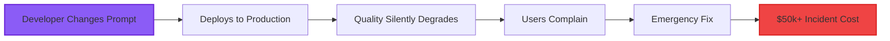
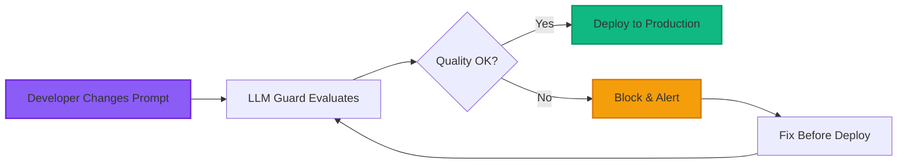
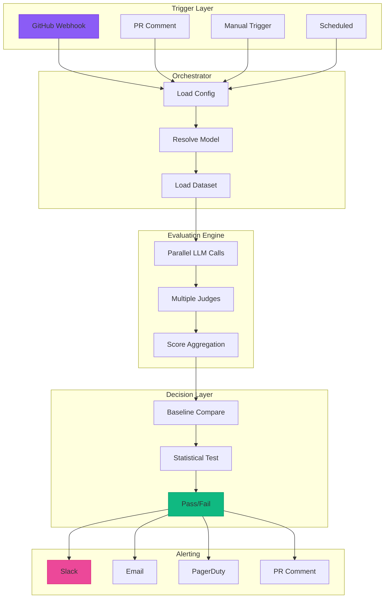

<div align="center">

# 🛡️ LLM Guard

### Elite Production-Grade Model Regression Detection System

[]()
[]()
[]()
[]()
[]()
[]()

**Ship LLM Features with Confidence** 🚀

[🚀 Quick Start](#-quick-start) • [📚 Documentation](#-documentation) • [🎨 Features](#-features) • [🌐 Deployment](#-deployment) • [🤝 Contributing](#-contributing)


</div>

---

## 📋 Table of Contents

- [🎯 Overview](#-overview)
- [✨ Features](#-features)
- [🎥 Demo](#-demo)
- [🚀 Quick Start](#-quick-start)
- [📦 Installation](#-installation)
- [🛠️ Usage](#-usage)
- [🏗️ Architecture](#-architecture)
- [📊 Tech Stack](#-tech-stack)
- [🌐 Deployment](#-deployment)
- [📚 Documentation](#-documentation)
- [🤝 Contributing](#-contributing)
- [📄 License](#-license)
- [👤 Author](#-author)
- [🙏 Acknowledgments](#-acknowledgments)
- [⭐ Star History](#-star-history)

---

## 🎯 Overview

<div align="center">
  
</div>

**LLM Guard** is an elite-tier, production-grade Model Regression Detection System that provides comprehensive quality assurance for LLM-powered applications. Built with cutting-edge technology and designed for enterprise-scale deployments.

### 🎬 The Problem

When you deploy LLM-powered features, you face critical challenges:



### ✅ The Solution



---

## ✨ Features

<div align="center">

| Category | Features |
|----------|----------|
| 🎯 **Quality Assurance** | ✅ 14 production-grade test cases<br>✅ Statistical significance testing<br>✅ Multi-environment promotion gates<br>✅ Real-time regression detection |
| 💰 **Cost Optimization** | ✅ Real model pricing tracking<br>✅ Budget forecasting<br>✅ Cost-per-run analytics<br>✅ Model comparison |
| 🎨 **Premium UI/UX** | ✅ Glassmorphism design<br>✅ 3D interactive orb<br>✅ Particle animations<br>✅ Keyboard shortcuts |
| 📊 **Analytics** | ✅ 30-day trend analysis<br>✅ Drift detection<br>✅ Latency percentiles<br>✅ Performance rankings |
| 🚨 **Alerting** | ✅ Multi-channel notifications<br>✅ Severity-based escalation<br>✅ Acknowledgment tracking<br>✅ Audit trail |
| 🔌 **Integration** | ✅ GitHub Actions<br>✅ Slack webhooks<br>✅ PagerDuty<br>✅ Custom webhooks |

</div>

### 🎥 Demo

<div align="center">


*Interactive dashboard with real-time metrics, 3D visualizations, and premium glassmorphism UI*

</div>

---

## 🚀 Quick Start

Get up and running in **less than 5 minutes**!

```bash
# Clone the repository
git clone https://github.com/YOUR_USERNAME/llm-guard.git
cd llm-guard

# Install dependencies
npm install

# Start development server
npm run dev

# Open http://localhost:5173
```

<div align="center">
  
  
  
</div>

---

## 📦 Installation

### Prerequisites

- **Node.js** v18.0.0 or higher ([Download](https://nodejs.org/))
- **npm** v9.0.0 or higher
- **Git** ([Download](https://git-scm.com/))

### Step-by-Step

```bash
# 1. Clone the repository
git clone https://github.com/YOUR_USERNAME/llm-guard.git

# 2. Navigate to project directory
cd llm-guard

# 3. Install dependencies
npm install

# 4. (Optional) Configure environment variables
cp .env.example .env
# Edit .env and add your API keys

# 5. Start development server
npm run dev
```

### Available Scripts

```bash
npm run dev          # Start dev server (http://localhost:5173)
npm run build        # Build for production
npm run preview      # Preview production build
npm run typecheck    # Run TypeScript type checking
```

---

## 🛠️ Usage

### 🎮 Keyboard Shortcuts

Press `?` or `⌘/` to view all shortcuts:

| Shortcut | Action |
|----------|--------|
| `⌘K` / `Ctrl+K` | Open command palette |
| `G D` | Go to Dashboard |
| `G R` | Go to Eval Runs |
| `G T` | Go to Trends |
| `G A` | Go to Alerts |
| `N` | New test case |
| `E` | Trigger evaluation |

### 📊 Views

<div align="center">

| View | Description |
|------|-------------|
| 🏠 **Dashboard** | Real-time quality metrics with 3D orb |
| ⚡ **Command Center** | Live system status and activity |
| 📈 **Eval Runs** | Evaluation history with statistics |
| 📋 **Golden Dataset** | Test case management |
| 🤖 **Model Registry** | Model configurations |
| 🏆 **Leaderboard** | Performance rankings |
| 🚨 **Alerts** | Alert management |
| 📊 **Trends** | Statistical drift analysis |
| 💰 **Cost Analytics** | Cost tracking & optimization |
| 🔄 **Pipeline** | CI/CD visualization |

</div>

---

## 🏗️ Architecture

<div align="center">



</div>

---

## 📊 Tech Stack

<div align="center">

### Frontend


### Libraries


### Deployment


</div>

---

## 🌐 Deployment

### 🚀 Deploy to Vercel (Recommended)

```bash
# Install Vercel CLI
npm install -g vercel

# Deploy
vercel --prod
```

### 🌐 Deploy to Netlify

```bash
# Install Netlify CLI
npm install -g netlify-cli

# Build and deploy
npm run build
netlify deploy --prod --dir=dist
```

### 🐳 Deploy with Docker

```bash
# Build image
docker build -t llm-guard .

# Run container
docker run -p 8080:80 llm-guard
```

📖 **Detailed deployment guide:** [DEPLOYMENT.md](./DEPLOYMENT.md)

---

## 📚 Documentation

<div align="center">

| Document | Description |
|----------|-------------|
| 📘 **[README.md](./README.md)** | Complete project documentation |
| 🚀 **[QUICKSTART.md](./QUICKSTART.md)** | Get started in 5 minutes |
| 🌐 **[DEPLOYMENT.md](./DEPLOYMENT.md)** | Deploy to any platform |
| 📖 **[COMPLETE_GUIDE.md](./COMPLETE_GUIDE.md)** | Everything you need to know |
| 💼 **[PROJECT_OVERVIEW.md](./PROJECT_OVERVIEW.md)** | Business value & ROI |
| ⭐ **[ELITE_FEATURES.md](./ELITE_FEATURES.md)** | Advanced features |

</div>

---

## 🤝 Contributing

Contributions are welcome! Here's how you can help:

### 🐛 Report Bugs

Open an issue with:
- Clear description
- Steps to reproduce
- Expected vs actual behavior
- Screenshots (if applicable)

### 💡 Suggest Features

Open an issue with:
- Feature description
- Use case
- Implementation ideas (optional)

### 🔧 Submit PRs

1. Fork the repository
2. Create feature branch: `git checkout -b feature/amazing-feature`
3. Commit changes: `git commit -m 'Add amazing feature'`
4. Push to branch: `git push origin feature/amazing-feature`
5. Open a Pull Request

### 📝 Code Style

- Use TypeScript strict mode
- Follow existing code patterns
- Add comments for complex logic
- Write meaningful commit messages

---

## 📄 License

This project is licensed under the MIT License - see the [LICENSE](./LICENSE) file for details.

```
MIT License

Copyright (c) 2024 YOUR_NAME

Permission is hereby granted, free of charge, to any person obtaining a copy
of this software and associated documentation files (the "Software"), to deal
in the Software without restriction...
```

---

## 👤 Author

<div align="center">

### YOUR_NAME

**Full-Stack Developer | AI/ML Enthusiast**

[](https://github.com/YOUR_USERNAME)
[](https://linkedin.com/in/YOUR_USERNAME)
[](https://twitter.com/YOUR_HANDLE)
[](https://your-website.com)

*Brief bio about yourself - 1-2 sentences describing your expertise and interests.*

</div>

---

## 🙏 Acknowledgments

- **OpenAI** - For GPT models and pricing data
- **Anthropic** - For Claude models and benchmarks
- **Google** - For Gemini models and documentation
- **Meta** - For Llama models and research
- **Vercel** - For deployment platform
- **React Team** - For the amazing framework
- **Vite Team** - For the blazing-fast build tool
- **Tailwind CSS** - For the utility-first CSS framework

---

## ⭐ Star History

<div align="center">

<a href="https://star-history.com/#YOUR_USERNAME/llm-guard&Date">
  <picture>
    <source media="(prefers-color-scheme: dark)" srcset="https://api.star-history.com/svg?repos=YOUR_USERNAME/llm-guard&type=Date&theme=dark" />
    <source media="(prefers-color-scheme: light)" srcset="https://api.star-history.com/svg?repos=YOUR_USERNAME/llm-guard&type=Date" />
    
  </picture>
</a>

</div>

---

## 📊 Project Stats

<div align="center">


</div>

---

<div align="center">

## 🎉 Show Your Support

If you find this project useful, please consider giving it a ⭐ star!

<a href="https://github.com/YOUR_USERNAME/llm-guard/stargazers">
  
</a>

---

**Built with ❤️ by YOUR_NAME**

[🔝 Back to Top](#-llm-guard)

</div>


