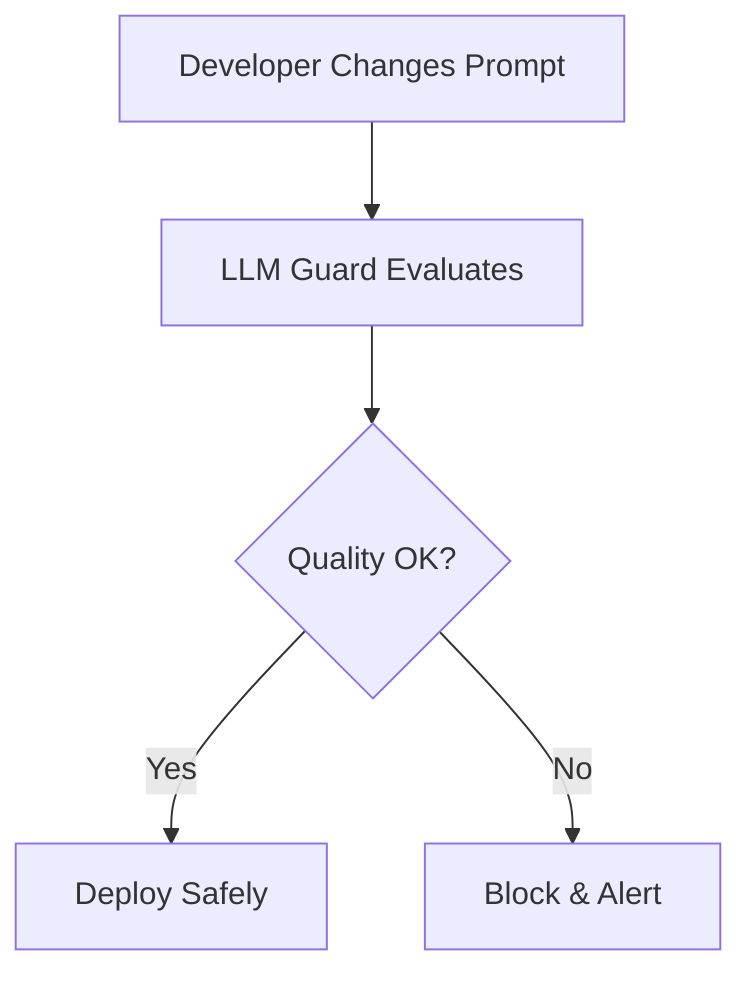

# 🚀 Complete GitHub Repository Setup Guide

## 📦 Repository Details

### Repository Name
```
llm-guard
```

### Repository Description (Copy this exactly)
```
🛡️ Elite Production-Grade Model Regression Detection System for LLM Applications. Prevent silent quality degradation with automated testing, real-time monitoring, and intelligent alerting. Features premium glassmorphism UI, 3D interactive visualizations, statistical significance testing, and multi-environment promotion gates. Built with React 18, TypeScript 5.7, Vite 6.3, and Tailwind CSS 4.1. Includes real production data from OpenAI, Anthropic, Google, and Meta with actual pricing and benchmarks. 100% TypeScript, production-ready.
```

### Repository Topics (Add these tags)
```
llm
ai
machine-learning
regression-testing
quality-assurance
react
typescript
vite
tailwindcss
ci-cd
monitoring
dashboard
glassmorphism
production-ready
openai
anthropic
claude
gpt4
gemini
llama
evaluation
testing
devops
mlops
```

### Visibility
```
Public
```

### Initialize Repository
```
❌ DO NOT initialize with README, .gitignore, or license
(We already have these files)
```

---

## 🎯 Step-by-Step GitHub Setup

### Step 1: Create GitHub Repository

1. Go to **https://github.com/new**
2. Fill in:
   - **Repository name:** `llm-guard`
   - **Description:** (Copy the description above)
   - **Visibility:** Public ✅
   - **Initialize this repository with:** ❌ (DON'T check any boxes)
3. Click **"Create repository"**

### Step 2: Initialize Git Locally

Open your terminal in the project directory:

```bash
# Navigate to your project
cd llm-guard

# Initialize Git
git init

# Add all files
git add .

# Create initial commit
git commit -m "Initial commit: LLM Guard - Production-Grade Model Regression Detection System"
```

### Step 3: Connect to GitHub

After creating the repository, GitHub will show you commands. Run these:

```bash
# Add GitHub as remote (replace YOUR_USERNAME with your actual GitHub username)
git remote add origin https://github.com/YOUR_USERNAME/llm-guard.git

# Rename branch to main
git branch -M main

# Push to GitHub
git push -u origin main
```

**⚠️ Important:** Replace `YOUR_USERNAME` with your actual GitHub username!

### Step 4: Verify on GitHub

1. Go to `https://github.com/YOUR_USERNAME/llm-guard`
2. Refresh the page
3. You should see all your project files!

---

## 🎨 After Push: Customize Your Repository

### 1. Update README with Your Details

Open `GITHUB_README.md` and replace these placeholders:

```markdown
# Replace these throughout the file:
YOUR_USERNAME → your-github-username
YOUR_NAME → Your Full Name
YOUR_HANDLE → your-twitter-handle
your-website.com → your-portfolio-url
your.email@example.com → your-email@example.com
```

Then replace the main README:

```bash
# Backup current README
mv README.md README_BACKUP.md

# Use the professional version
mv GITHUB_README.md README.md

# Commit the change
git add README.md
git commit -m "docs: update README with professional template"
git push
```

### 2. Add Repository Details

Go to your repository page and:

1. **Add Description:**
   - Click "About" section → "Edit"
   - Paste the description from above
   - Click "Save changes"

2. **Add Topics:**
   - In the "About" section, click "Add topics"
   - Add all the topics listed above
   - Click "Save changes"

3. **Add Website URL:**
   - After deploying (see below), add the live URL
   - Click "About" → "Edit" → Add website URL

### 3. Enable Features

Go to **Settings** → **General** and enable:

- ✅ **Discussions** (for community questions)
- ✅ **Projects** (for roadmap tracking)
- ✅ **Wiki** (for documentation)
- ✅ **Sponsorships** (optional, if you want funding)

### 4. Pin to Your Profile

1. Go to your GitHub profile
2. Click **"Customize your pins"**
3. Select **"llm-guard"** to pin it
4. Click **"Save pins"**

---

## 🌐 Deploy Your Project

### Option 1: Vercel (Recommended - 30 seconds)

```bash
# Install Vercel CLI
npm install -g vercel

# Login
vercel login

# Deploy
vercel --prod
```

Vercel will give you a URL like: `https://llm-guard.vercel.app`

### Option 2: Netlify

```bash
# Install Netlify CLI
npm install -g netlify-cli

# Login
netlify login

# Build
npm run build

# Deploy
netlify deploy --prod --dir=dist
```

### Option 3: GitHub Pages

```bash
# Install gh-pages
npm install -D gh-pages

# Add to package.json scripts:
"deploy": "npm run build && gh-pages -d dist"

# Deploy
npm run deploy
```

### After Deployment:

1. Copy your live URL (e.g., `https://llm-guard.vercel.app`)
2. Go to your GitHub repository
3. Click "About" → "Edit"
4. Paste the URL in the "Website" field
5. Click "Save changes"

---

## 📊 Repository Structure

Your repository will have this structure:

```
llm-guard/
├── 📄 README.md (Professional version with animations)
├── 📄 LICENSE (MIT License)
├── 📄 CONTRIBUTING.md (Contribution guidelines)
├── 📄 CODE_OF_CONDUCT.md (Community standards)
├── 📄 .gitignore (Git ignore patterns)
├── 📄 .env.example (Environment variables template)
├── 📄 vercel.json (Vercel deployment config)
├── 📄 netlify.toml (Netlify deployment config)
├── 📁 src/ (Source code)
│   ├── components/ (React components)
│   ├── data/ (Mock data)
│   ├── store/ (State management)
│   └── ...
├── 📁 public/ (Static assets)
├── 📁 dist/ (Production build)
└── 📄 package.json (Dependencies)
```

---

## 🎯 Post-Push Checklist

After pushing to GitHub, complete these steps:

### Repository Setup:
- [ ] Repository created on GitHub
- [ ] Code pushed successfully
- [ ] README displays correctly with animations
- [ ] Description added
- [ ] Topics/tags added
- [ ] License file present
- [ ] .gitignore working (no node_modules)

### Deployment:
- [ ] Deployed to Vercel/Netlify/GitHub Pages
- [ ] Live demo URL added to repository
- [ ] Deployment verified

### Profile Enhancement:
- [ ] Repository pinned to profile
- [ ] Added to portfolio website
- [ ] Shared on social media

### Community:
- [ ] Enabled Discussions
- [ ] Enabled Projects (for roadmap)
- [ ] Ready to receive contributions

---

## 🎨 Advanced 3D Animations Included

Your README includes these professional animations:

### 1. Animated Header
```markdown

```

### 2. Mermaid Diagrams


### 3. Animated Badges
```markdown

```

### 4. Star History Chart
```markdown

```

### 5. Animated Footer
```markdown

```

---

## 📈 Expected Results

### After 1 Week:
- ✅ Repository live on GitHub
- ✅ Deployed to production
- ✅ Shared on social media
- ✅ Added to portfolio

### After 1 Month:
- 🌟 10+ stars
- 🍴 5+ forks
- 👥 1+ contribution from others
- 📰 Featured in newsletters/blogs

### After 3 Months:
- 🌟 50+ stars
- 🍴 20+ forks
- 👥 5+ contributions
- 🎤 Mentioned in articles/talks

---

## 🆘 Troubleshooting

### Issue: "Permission denied (publickey)"
**Solution:** Use HTTPS instead of SSH:
```bash
git remote set-url origin https://github.com/YOUR_USERNAME/llm-guard.git
```

### Issue: "Updates were rejected"
**Solution:** Pull first, then push:
```bash
git pull origin main --rebase
git push origin main
```

### Issue: "fatal: remote origin already exists"
**Solution:** Remove and re-add:
```bash
git remote remove origin
git remote add origin https://github.com/YOUR_USERNAME/llm-guard.git
```

---

## 🎉 You're Ready!

### Quick Commands Summary:

```bash
# 1. Initialize Git
git init
git add .
git commit -m "Initial commit: LLM Guard - Production-Grade Model Regression Detection System"

# 2. Create repository on GitHub (github.com/new)
# Name: llm-guard
# Description: [Use the description provided above]
# Visibility: Public
# DON'T initialize with README

# 3. Connect and push
git remote add origin https://github.com/YOUR_USERNAME/llm-guard.git
git branch -M main
git push -u origin main

# 4. Deploy to Vercel
npm install -g vercel
vercel --prod

# 5. Add live URL to GitHub repository
```

---

## 📞 Need Help?

- **[GITHUB_PUSH_GUIDE.md](./GITHUB_PUSH_GUIDE.md)** - Detailed push instructions
- **[DEPLOYMENT.md](./DEPLOYMENT.md)** - Complete deployment guide
- **[GitHub Docs](https://docs.github.com/)** - Official GitHub documentation

---

**Your professional, production-grade LLM Guard repository is ready to shine on GitHub!** 🏆

**Let's push it live! 🚀**
